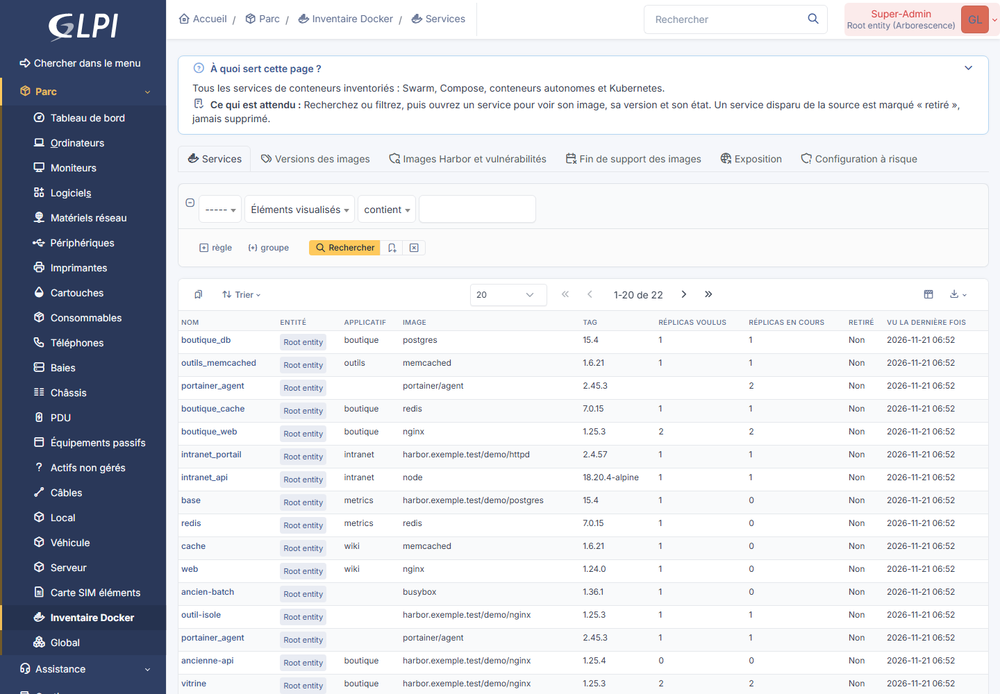
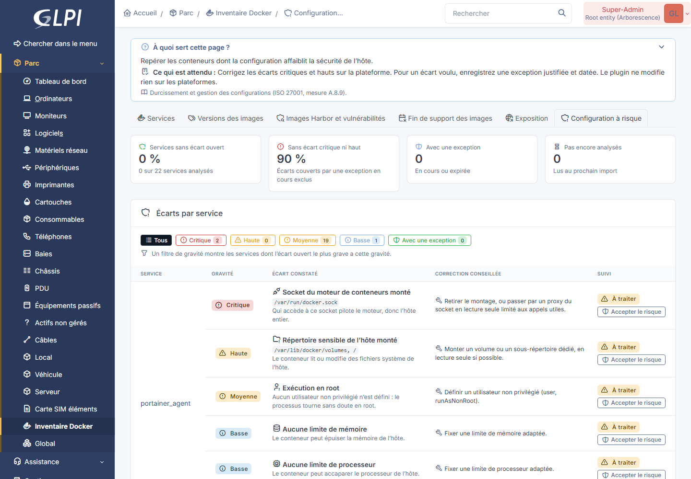

# Annonce du forum GLPI

Texte à publier sur [forum.glpi-project.org](https://forum.glpi-project.org/), catégorie
**Plugins GLPI > Discussions, questions, remarques/remarks... Plugins**. Format repris des annonces
de plugins de cette catégorie (titre « [New Plugin] », libellés en gras, anglais puis français
après une ligne horizontale, une ou deux captures, appel aux retours).

Avant de publier : remplacer `X.Y.Z` par la dernière version et glisser les captures dans l'éditeur
(le forum les héberge et les affiche en vignette) ou garder les liens ci-dessous.

**Titre** :

```text
[New Plugin] Docker Inventory: read-only inventory of containers, exposure and risky configuration (GLPI 11 & 12)
```

**Message** :

---

Hello everyone,

I am sharing **Docker Inventory**, a free and open-source plugin (GPL-3.0) that gives GLPI a
**read-only** view of containerised applications. It answers "what is running, in which version,
is it up to date, is it vulnerable, is it exposed?". The native "Virtualization" tab only lists
isolated containers, with no stack, service or version.



**What it does**

- **Inventory**: imports Docker Swarm stacks and services, standalone Docker hosts with their
  Compose stacks, and Kubernetes namespaces and workloads from **Portainer** and **Kubernetes**.
  Stacks become native GLPI Appliances (impact analysis), nodes are linked to inventoried computers.
- **Versions**: deployed and latest available version of each image, from **What's Up Docker** or
  directly from Docker Hub and Harbor registries, with the type of gap (patch, minor, major).
- **Vulnerabilities**: **Harbor** scan summary per image, images outside your managed registries
  flagged, product end of life from endoflife.date, tickets suggested above your thresholds.
- **Exposure**: published ports, Traefik routes, Kubernetes ingresses and NodePort/LoadBalancer
  services, with the reach of each exposure (likely Internet, host network, internal).
- **Risky configuration**: privileged mode, mounted Docker socket, shared host network or
  processes, dangerous capabilities, running as root, no memory or CPU limit, sensitive host paths
  mounted. Each finding has a severity, an explanation, a suggested fix, and can be covered by a
  justified exception with an end date.



More screenshots: [service exposure](https://raw.githubusercontent.com/parime/glpi-docker-inventory/main/docs/screenshots/exposition.png),
[service record](https://raw.githubusercontent.com/parime/glpi-docker-inventory/main/docs/screenshots/fiche-service.png),
[image versions](https://raw.githubusercontent.com/parime/glpi-docker-inventory/main/docs/screenshots/versions-images.png),
[settings](https://raw.githubusercontent.com/parime/glpi-docker-inventory/main/docs/screenshots/reglages.png)
(French interface, fictitious data).

**Read-only by design**: the plugin never redeploys, restarts or deletes anything, and changes
nothing in GLPI on its own (a service that disappears is marked "retired"). It uses read-only
accounts, API keys are encrypted with the GLPI key, and only the names of Docker secrets are
imported, never their content.

**Works with the other plugins**: with [GRC Manager](https://github.com/parime/glpi-iso27001-management),
each exposure is compared to the flow matrix (an undocumented exposure is flagged and a flow can be
proposed) and the plugin provides ISO 27001 evidence (configuration hardening, vulnerabilities).
Without it, everything works on its own.

**Installation**: from **Setup > Plugins > Marketplace** (search "Docker Inventory"), or download
`glpi-docker-inventory-X.Y.Z.zip` from the [releases](https://github.com/parime/glpi-docker-inventory/releases)
and unzip it into `plugins/`. No Composer needed. Then add a connection in the plugin page
(**Setup > Plugins > Docker Inventory**), test it and run an import.

**Compatibility**: GLPI 11.0 and 12.x, PHP 8.2 to 8.5 (8.3+ with GLPI 12). Portainer CE/BE 2.x,
Kubernetes 1.24+, What's Up Docker 8.x, Harbor 2.x. Interface in 7 languages (English, French,
German, Spanish, Italian, Portuguese, Polish).

**Links**

- Repository and documentation: https://github.com/parime/glpi-docker-inventory
- Marketplace page: https://plugins.glpi-project.org/#/plugin/dockerinventory
- Issues and ideas: https://github.com/parime/glpi-docker-inventory/issues

**Feedback welcome**: which platforms do you run (Swarm, standalone Docker, Kubernetes, Portainer
or not)? What would you need to see about your containers in GLPI? Bug reports, ideas and
translations are welcome here in this thread or on GitHub.

---

**En français**

Bonjour à tous,

Je partage **Inventaire Docker**, un plugin libre et gratuit (GPL-3.0) qui donne à GLPI une vue
**en lecture seule** sur les applications en conteneurs : qu'est-ce qui tourne, en quelle version,
est-ce à jour, est-ce vulnérable, est-ce exposé ? L'onglet « Virtualisation » de GLPI ne liste que
des conteneurs isolés, sans stack, sans service ni version.

**Ce qu'il fait**

- **Inventaire** : stacks et services Docker Swarm, hôtes Docker autonomes et leurs stacks
  Compose, namespaces et charges Kubernetes, importés depuis **Portainer** et **Kubernetes** ; les
  stacks deviennent des Applications GLPI, les nœuds sont rattachés aux ordinateurs inventoriés.
- **Versions** : version déployée et dernière version de chaque image (**What's Up Docker** ou
  registres Docker Hub et Harbor), avec le type d'écart (correctif, mineure, majeure).
- **Vulnérabilités** : résumé d'analyse **Harbor** par image, images hors registre maîtrisé, fin de
  support des produits (endoflife.date), tickets proposés selon vos seuils.
- **Exposition** : ports publiés, routes Traefik, ingress et services Kubernetes, avec la portée de
  chaque exposition (Internet probable, réseau de l'hôte, interne).
- **Configuration à risque** : mode privilégié, socket Docker monté, réseau ou processus de l'hôte
  partagés, capacités dangereuses, exécution en root, absence de limites, répertoires sensibles
  montés ; gravité, explication, correction conseillée et exceptions justifiées et datées.

Captures : [services](https://raw.githubusercontent.com/parime/glpi-docker-inventory/main/docs/screenshots/services.png),
[exposition](https://raw.githubusercontent.com/parime/glpi-docker-inventory/main/docs/screenshots/exposition.png),
[configuration à risque](https://raw.githubusercontent.com/parime/glpi-docker-inventory/main/docs/screenshots/configuration-risque.png),
[fiche d'un service](https://raw.githubusercontent.com/parime/glpi-docker-inventory/main/docs/screenshots/fiche-service.png),
[réglages](https://raw.githubusercontent.com/parime/glpi-docker-inventory/main/docs/screenshots/reglages.png).

**Lecture seule** : le plugin ne redéploie, ne redémarre et ne supprime jamais rien, et ne modifie
rien seul dans GLPI. Comptes en lecture seule, clés d'API chiffrées avec la clé de GLPI, noms des
secrets importés, jamais leur contenu. Avec [GRC Manager](https://github.com/parime/glpi-iso27001-management),
chaque exposition est comparée à la matrice des flux et des preuves ISO 27001 sont fournies.

**Installation** : **Configuration > Plugins > Marketplace** (chercher « Inventaire Docker »), ou
archive `glpi-docker-inventory-X.Y.Z.zip` des [releases](https://github.com/parime/glpi-docker-inventory/releases)
à décompresser dans `plugins/`. Ensuite, ajoutez une connexion dans la page du plugin
(**Configuration > Plugins > Inventaire Docker**), testez-la et lancez un import.
GLPI 11.0 et 12.x, PHP 8.2 à 8.5.

**Liens** : [dépôt et documentation](https://github.com/parime/glpi-docker-inventory) ·
[fiche du marketplace](https://plugins.glpi-project.org/#/plugin/dockerinventory) ·
[issues et idées](https://github.com/parime/glpi-docker-inventory/issues)

**Vos retours sont les bienvenus** : quelles plateformes utilisez-vous (Swarm, Docker autonome,
Kubernetes, avec ou sans Portainer) ? Qu'aimeriez-vous voir de vos conteneurs dans GLPI ?
Signalements, idées et traductions ici ou sur GitHub.
